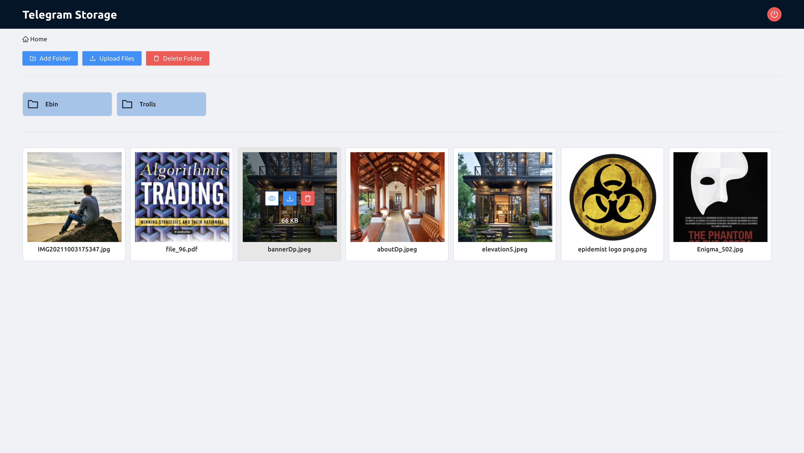

# Telegram Cloud Storage

### Environment variables required

Create a file `.env` on the root folder with the following credentials.

/server/database/database.ts

"mongodb://@localhost:27017/it_kb?authSource=admin";

`mongoPassword = ******`

`mongoUser = ******`

`jwtSecret = ******`

### export db

docker exec -i <tên_hoặc_id_container> mongodump \
  --username=postgres \
  --password=postgres \
  --authenticationDatabase=admin \
  --db=it_kb \
  --archive > backup_it_kb.gz

### import db

docker exec -i <tên_hoặc_id_container> mongorestore \
  --username=postgres \
  --password=postgres \
  --authenticationDatabase=admin \
  --archive < backup_it_kb.gz

### Installation

- `npm install`

### Start Servers

For development we have 2 servers for Node and React.

nvm install 16

nvm use 16

npm rebuild bcrypt --update-binary

- `npm run react:dev`
- `npm run node:dev`

Now the UI will be available at http://localhost:3001

## Register new user

9217020131:AAFrT2lZGl9QHcsq5liDUv88p7jghE5SwME

"id": -5453182990,

[Read here](https://github.com/ebinxavier/telegramCloudStorage/blob/main/ui/public/help/help.md)
